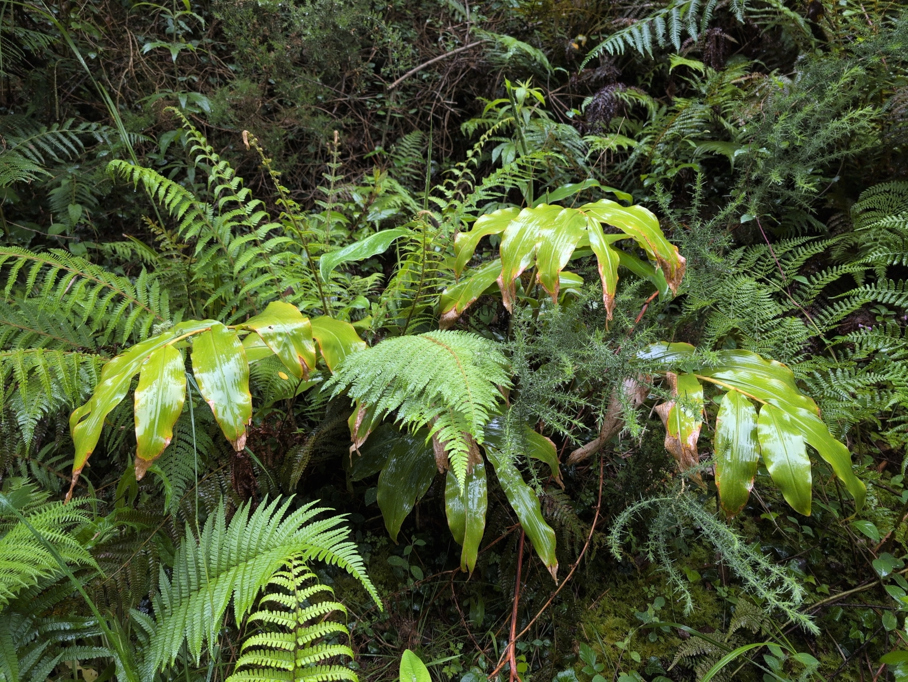

```{r setup, include=FALSE}
knitr::opts_chunk$set(echo = TRUE)
```



# Subtropical refugia in Atlantic Europe become invasion hotspots under climate change

This repository stores all the information related to the manuscript *Subtropical refugia in Atlantic Europe become invasion hotspots under climate change*, including the datasets, and the scripts to perform data analysis.

## Contents

This repository is organised following the advice of [Wilson et al. 2017](https://doi.org/10.1371/journal.pcbi.1005510) for recording and storing research projects.

The following materials are available in the folders of this repository:

* `data` Dataset of curated species occurrence points.
* `src` Scripts in `R` language to perform the SDMs and other analyses in the manuscript.
* `results` Output of the `R` scripts, including figures, SDMs evaluation and outputs, hotspot cell counts, species-level results, and model projections.
* `doc` Manuscript files.

## Citation

Please cite the repository as: 

> Jorge Casado-Valledor, Adrián Lázaro-Lobo, Víctor González-García, Eduardo Fernández-Pascual (2026) Subtropical refugia in Atlantic Europe become invasion hotspots under climate change.